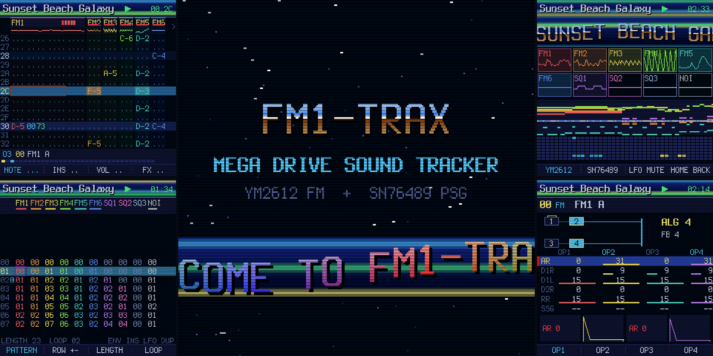

# FM1-TRAX

Custom firmware that turns the M-VAVE FM-1 into a **Sega Mega Drive / Genesis music tracker**. It
emulates the console's two sound chips, the Yamaha YM2612 (six FM channels) and the SN76489 PSG
(three square waves and noise), and gives you a pattern tracker in the style of Deflemask and
Furnace, played from the FM-1's own keys and knobs. (FM1-TRAX was called FM1-DRIVE until October 2026.)

> **Status: in development, tested on a real FM-1.** Everything runs and is tested in the host
> simulator (`tests/run_tests.sh`), and the firmware has been tested on a real FM-1. The firmware comes
> with no warranty: see [No warranty](#no-warranty) before you install it.



## What it does

- **The real chips, limits included.** 6 FM channels with 4 operators each, the 8 algorithms,
  feedback, SSG-EG, the global LFO, FM3's extended mode (four independent operator pitches), and the
  DAC on FM6 for samples. 3 PSG tone channels and the noise channel, with periodic and white noise.
  The YM2612's 9-bit DAC ladder, the low-pass filter of the model 1 or model 2 console, and NTSC or
  PAL timing.
- **A tracker.** Up to 256 patterns per channel and 256 order positions, 1 to 256 rows, two speeds
  (shuffle), row highlights, and Deflemask's Genesis effects (arpeggio, portamento, vibrato, volume
  slide, pan, retrigger, operator levels, LFO, note cut and delay, and more).
- **Instruments.** 128 FM presets in 16 groups, 32 PSG presets and a 48-sample drum kit. Load any of
  them into a song and tweak it, or build your own. **256 user FM and 128 user PSG slots** in the
  library.
- **Lots of songs.** **256 song slots** sharing about 258 KB of flash. Songs are compressed, so the
  demo song, a 2-minute piece, takes about 4.6 KB. Saves are power-safe: a song is replaced only once its new copy is
  complete, and the flash wear is spread evenly.
- **Fun to look at.** A boot intro with a star field, a chrome logo and a sine scroller; CRT
  scanlines, copper bars and screen wipes; a stage view with scopes, a piano roll and a heat map of
  the YM2612's registers. Six colour themes, including high-contrast and colour-blind-safe ones.
- **Export.** VGM 1.71 export (to play in any VGM player, or on real hardware), and the songs and
  library moved to and from a computer over USB MIDI SysEx.

## No warranty

FM1-TRAX is provided "as is", without warranty of any kind, express or implied, including the implied
warranties of merchantability and fitness for a particular purpose. Installing custom firmware can
leave a device unable to start ("bricked") and may void its warranty. You install it at your own risk:
the author is not responsible for a bricked or damaged device, lost songs or data, or any other harm
that comes from using it. This is the same disclaimer as sections 15 and 16 of the [GPL-3.0](LICENSE),
which governs. Know the [recovery steps](#recovery) before you install.

## Installing

Get `fm1trax.fwsc` from the [releases](https://github.com/jartificer/fm1-trax/releases) (it is also kept in `web/`, or build it yourself: see [BUILDING.md](BUILDING.md)). Then,
with the FM-1 connected over USB:

```
pip install mido python-rtmidi
python3 tools/fm1_install.py fm1trax.fwsc
```

python-rtmidi comes ready-built for Python 3.8 to 3.12 on Windows, macOS and Linux. With a newer
Python, pip has to compile it, which needs a C++ compiler (and on Linux the ALSA headers,
`libasound2-dev`); installing Python 3.12 alongside is simpler. [INSTALL.md](INSTALL.md) has the steps
for Windows, macOS and Linux, and `tools/make_bundle.sh` packs it with the firmware and the installer
into one zip.

This works from the stock firmware or any Felucca-based firmware (FM1-GM, X0X, FoMni). To go back,
install M-VAVE's stock package the same way, or with M-VAVE's updater.

FM1-TRAX keeps its songs and instruments in its own format. It **cannot read the projects, patterns,
presets or samples of other firmwares** (the stock firmware or other custom firmwares), and its song
store may overwrite data another firmware left in the flash, so back up anything you want to keep
before you install it. Likewise, other firmwares cannot read FM1-TRAX's songs: back them up from the
web editor (as `.fm1d` files or VGM) before you install something else.

Or from the browser: the page in `web/` installs over Web MIDI in Chrome, Edge or Opera on a computer
(the same update as `fm1_install.py`).

Holding OCT- and OCT+ for 5 seconds puts FM1-TRAX into update mode, for an installer that cannot
reach it otherwise.

### Recovery

After two failed starts in a row the firmware comes up in a safe mode with USB on and no audio, so an
installer can reach it; PLAY tries the firmware again. After four, it enters the chip's own update
mode, the last resort: `tools/fm1_rescue.py` writes the stock firmware back through it (see the
script's header and [FM-1-transporter](https://github.com/kurogedelic/FM-1-transporter)).

## Emulator and editor

The `web/` folder is a website (published from the `gh-pages` branch once the repository is public):

- **Emulator**: the firmware compiled to WebAssembly, on a drawing of the FM-1's panel, played with the
  mouse or the computer keyboard. Songs saved there stay in the browser.
- **Installer**: installs the firmware on an FM-1 over USB MIDI (Chrome, Edge or Opera).
- **Editor**: a desktop tracker on the same engine, with Furnace-style keys: patterns, orders,
  instruments (FM operators with envelope graphs, macros drawn with the mouse, DAC samples), presets,
  undo, copy and paste, transpose. It opens and saves `.fm1d` songs and `.fm1i` instruments,
  **imports Mega Drive VGMs** (`.vgm` / `.vgz`, as logged by Deflemask, Furnace or an emulator) as
  songs to edit, exports **VGM** and **WAV**, and reads and writes the songs and the library of an FM-1 over USB (or of the
  emulator in another tab).

The demo song is "Sunset Beach Galaxy" by Tobikomi, from the YM2017 cart (GPL-3.0), imported from
its VGM (see `assets/songs/README.md`).

## Controls

The four knobs always edit four things side by side. In the pattern they are the cell's note,
instrument, volume and effect. In the FM editor they are the same parameter on the four operators,
like faders on a mixer.

| Button | |
|---|---|
| HOME | Pattern view; again: the stage view |
| SEQ | Order list; again: song settings |
| EDIT | Instrument editor (the instrument under the cursor); its SEL: the library |
| GLO | Songs (load, save, new, delete); again: setup |
| PLAY | Play and stop; held: play from the top |
| REC | Edit mode: the keys write notes (and record live while playing) |
| SAVE | Save the song |
| ARP | Undo; again: redo |
| PRESETS | The instrument the keys play |
| SELECT / ALGORITHM | Row / channel in the pattern |
| FX | The knobs switch to the effect columns |
| SEL | Hold and turn SELECT or ALGORITHM to mark a block. Tap: copy. Hold 1 s: paste |
| ENV | Key-off; with a block marked: clear it |
| LFO | Mute the channel; held: solo |

The full control map, view by view, is in [docs/DESIGN.md](docs/DESIGN.md#5-controls).

## Building

See [BUILDING.md](BUILDING.md).

## Credits and licence

FM1-TRAX is GPL-3.0-only (see `LICENSE`). It is built on
[FM1-GM](https://github.com/jartificer/fm1-gm)'s platform, which comes from
[Felucca](https://github.com/hugelton/Felucca), [X0X](https://github.com/charlesvestal/fm1-x0x) and
[FoMni](https://github.com/charlesvestal/fm1-fomni): the hardware layer, the update loader, the USB
stack and the installer. The chip emulation, the tracker, the presets, the drum samples (synthesised
by `tools/gen_drums.py`), the song store and the screens are new.

The tests compare the YM2612 emulation with [Nuked-OPN2](https://github.com/nukeykt/Nuked-OPN2)
(LGPL-2.1), which is downloaded for the tests only and is not part of the firmware.

M-VAVE, Sega, Mega Drive and Genesis are trademarks of their owners. This project is not affiliated
with them.
